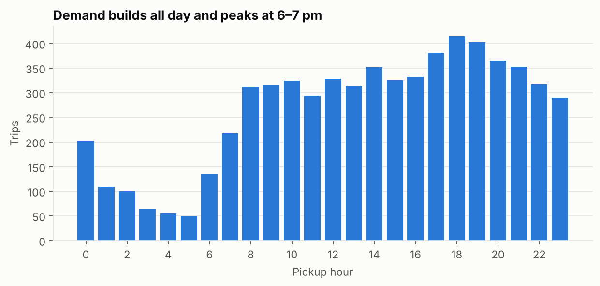
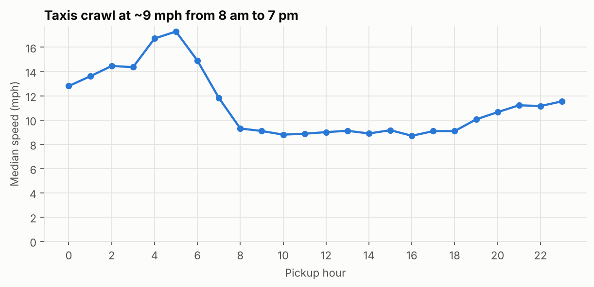
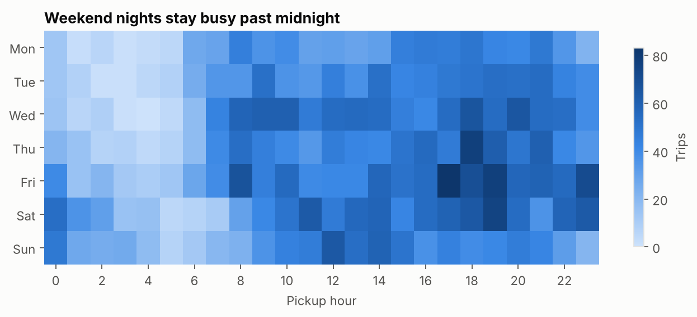
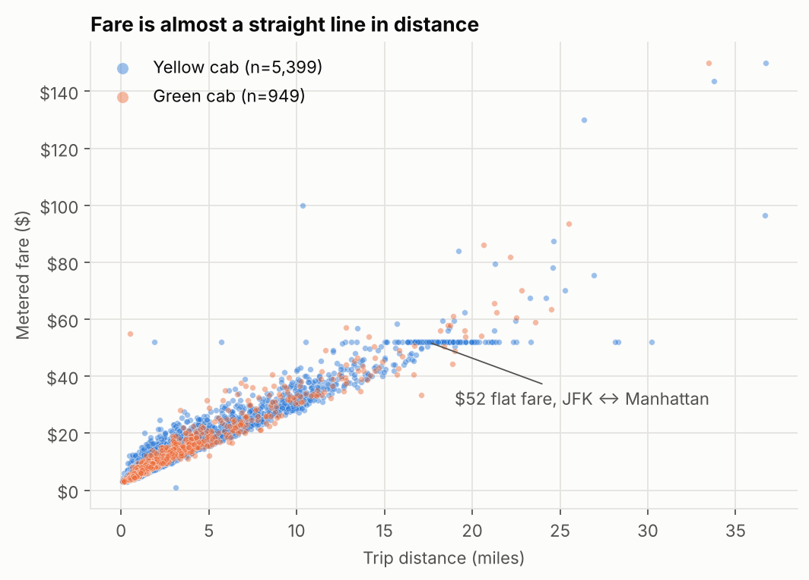
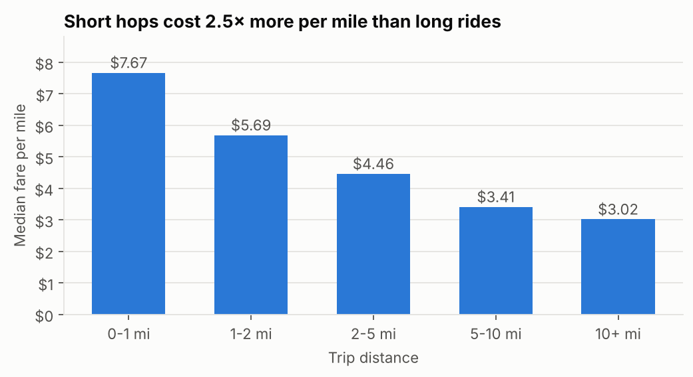
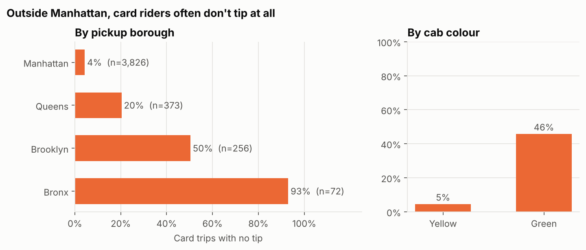
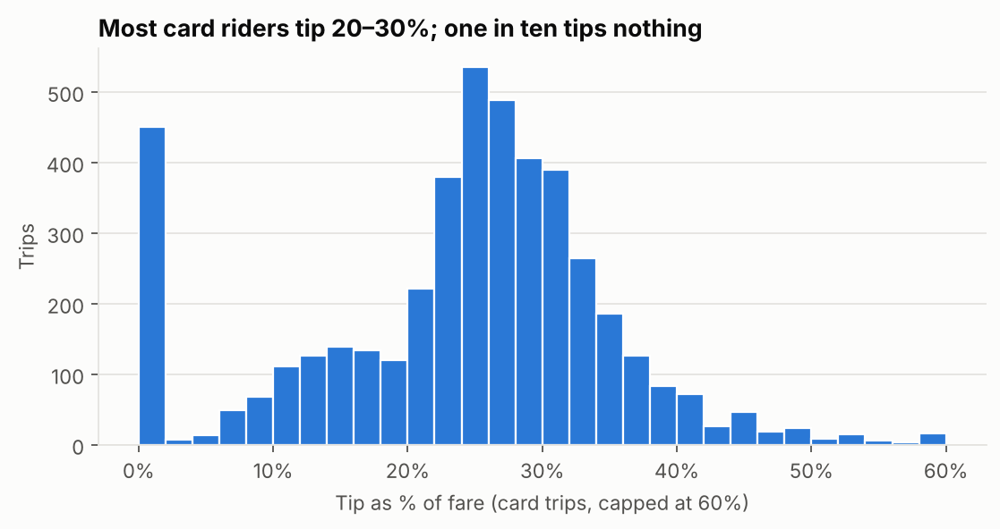
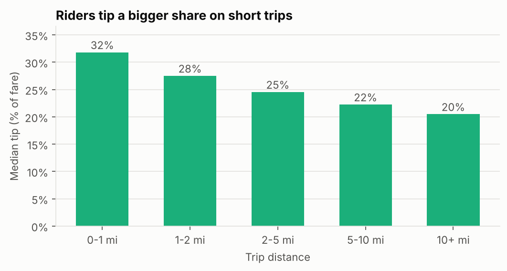

# NYC Taxi Trips — March 2019

When do New Yorkers take taxis, what does a ride really cost, and who tips?
An exploratory analysis of 6,433 yellow and green cab trips from the NYC Taxi & Limousine Commission (TLC) trip records.

**Notebook:** [`notebooks/nyc_taxi_analysis.ipynb`](notebooks/nyc_taxi_analysis.ipynb)

## Key findings

| | Finding |
|---|---|
| 🕕 Demand | Trips build all day and peak at **6–7 pm**. Friday and Saturday are the busiest days, and 55% of 0–4 am trips happen on weekends (vs 30% of all trips). |
| 🚦 Traffic | The median taxi moves at **~9 mph from 8 am to 7 pm**, about half its pre-dawn speed (17 mph at 5 am). |
| 💵 Fares | Fare ≈ **$2.39 + $2.07/mile + $0.30/minute** (linear model, test R² = 0.97, MAE = $0.67). Rides under a mile cost **$7.67/mile**, 2.5× the rate of 10+ mile trips. |
| ✈️ Airports | Airport trips are 6% of rides but have a median total of **$50** vs $14. The $52 JFK↔Manhattan flat fare shows up as a horizontal line in the data. |
| 💳 Tipping | Cash tips aren't recorded, so tipping is measured on card trips: median tip is **26% of the fare**. Only 4% of Manhattan card trips go untipped, vs **50% in Brooklyn and 93% in the Bronx**. Green cabs are tipped far less, even within Manhattan (19% untipped vs 4%). |

## Figures

<p>


</p>



<p>


</p>



<p>


</p>

## Method

1. **Cleaning** (`src/taxi.py`) — 85 of 6,433 rows removed: zero-distance trips (51), trips under 1 minute or over 3 hours (32), a pickup outside March (1) and an implausible speed over 70 mph (1). Each rule's count is logged in the notebook.
2. **Features** — duration, speed, fare per mile, hour / day of week, airport flag, distance band, tip as % of fare (card trips only).
3. **Analysis** — descriptive statistics and charts; a linear regression of fare on distance and duration (75/25 train/test split); a Mann–Whitney U test comparing yellow vs green tip percentages (p < 1e-90).

## Limitations

- A ~6k-trip sample from a single month, so seasonal and long-term patterns aren't visible.
- Cash tips are not captured by the TLC, so all tipping results describe card payers only.
- Tip % is computed on the metered fare; in-cab screens suggest tips on the total including surcharges, so these percentages run a few points higher than what riders select.
- Borough tipping gaps in the Bronx and Brooklyn rest on small samples (72 and 256 card trips).

## Run it yourself

```bash
git clone https://github.com/ghazalsprr/nyc-taxi-analysis.git
cd nyc-taxi-analysis
python -m venv .venv && source .venv/bin/activate   # Windows: .venv\Scripts\activate
pip install -r requirements.txt
jupyter lab notebooks/nyc_taxi_analysis.ipynb
```

Run all cells to rebuild the cleaned data and every figure.

**Tools:** Python · pandas · NumPy · matplotlib · SciPy · scikit-learn · Jupyter

## Structure

```
nyc-taxi-analysis/
├── data/
│   ├── raw/taxis.csv            # original sample
│   └── processed/               # cleaned output written by the notebook
├── figures/                     # PNGs saved by the notebook
├── notebooks/nyc_taxi_analysis.ipynb
├── src/
│   ├── taxi.py                  # loading, cleaning, feature engineering
│   └── plotting.py              # shared chart style
└── requirements.txt
```

## Data source

NYC Taxi & Limousine Commission, [TLC Trip Record Data](https://www.nyc.gov/site/tlc/about/tlc-trip-record-data.page), March 2019 — via the `taxis` sample in the [seaborn example datasets](https://github.com/mwaskom/seaborn-data).
